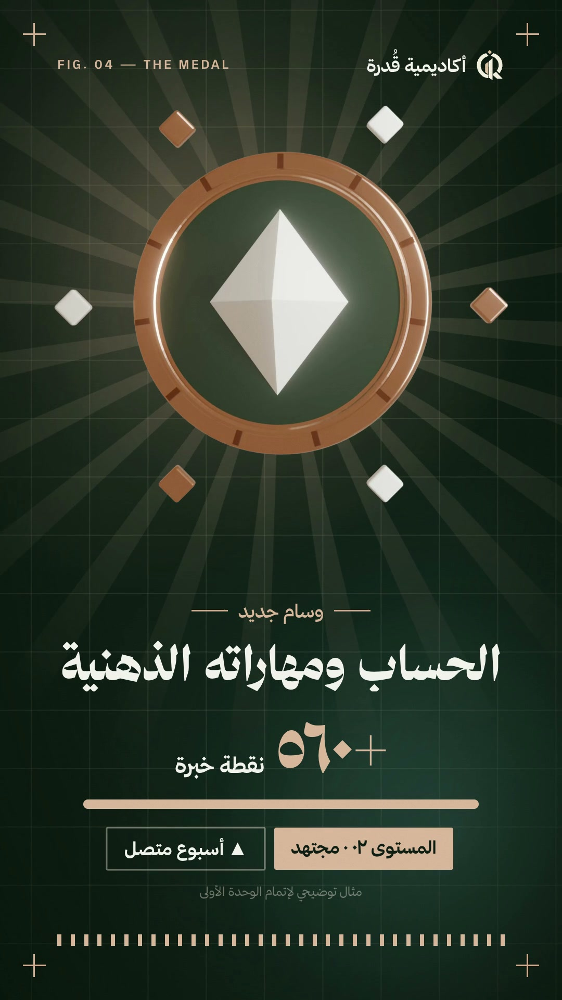

# Arabic launch video — a Claude Code plugin

Ask Claude Code *"make an Arabic ad for this project"* and it interviews you (goal, platform,
voice, materials), lists what it still needs (files, a link, a voice key), then builds a
15-35 s vertical video: Arabic RTL motion graphics in your product's palette, a **Modern
Standard Arabic (فصحى) voiceover**, a ducked music bed and beat-synced sound effects —
optionally with Blender 3D shots. A second skill adds فصحى narration to a video you already have.

[](media/qudrah-academy.mp4)

## Install

In Claude Code:

```text
/plugin marketplace add TurkiHassan/arabic-launch-video
/plugin install arabic-launch-video@arabic-launch-video
```

or from a shell: `claude plugin marketplace add TurkiHassan/arabic-launch-video && claude plugin install arabic-launch-video@arabic-launch-video`.
Start a new session, then run `/arabic-launch-video` or `/arabic-voiceover`. The skill runs
`scripts/doctor.sh` first and offers to install what is missing (Node 20+, ffmpeg, Python 3,
the [brag](https://github.com/latent-spaces/brag) plugin for music/SFX, and the
[Hyperframes](https://github.com/heygen-com/hyperframes) skills).

## Voice engines

| Engine | Setup | Notes |
|---|---|---|
| Gemini TTS, voice Charon (default) | free key from aistudio.google.com/apikey | best فصحى; ~10 requests/day/model on the free tier |
| edge-tts (`ar-SA-HamedNeural`) | none | instant, flatter read |
| ElevenLabs Haytham | paid plan for API | expressive; needs full tashkeel to stay فصحى |
| Your own recording | none | `vo1…voN` files from a phone |

Keys go into a private file created by `scripts/key_setup.sh` — never into the chat.
What keeps the read in فصحى: full tashkeel including case endings, numbers written as words,
foreign names spelled as spoken, and trimming long pauses (`tighten_pauses.py`).

## Layout

See the tree at the end of [README.md](README.md). The skills are in `skills/`, the shared
scripts in `scripts/`, two reference compositions in
`skills/arabic-launch-video/references/examples/` (HTML only — fonts, music and voice files
are not redistributed).

License: MIT. Music (ende.app) and SFX (Kenney, CC0) come from the brag plugin; check the
music terms before paid advertising.
