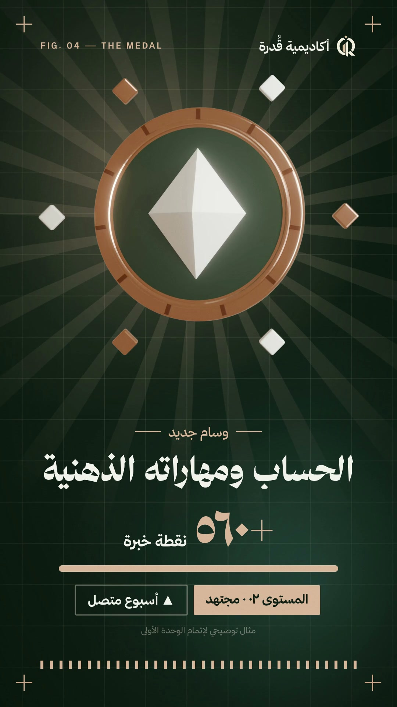
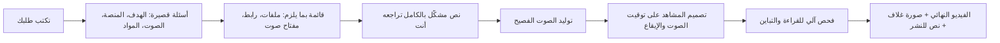

<div dir="rtl">

# إعلان عربي بتعليق فصيح — بمحادثة واحدة مع Claude

اكتب لـ Claude: «سوّ لي إعلان عربي لتطبيقي»، فيسألك عن هدفك وما لديك، ثم يصنع لك فيديو إعلانيًا عموديًا بالعربية: نصوص متحركة من اليمين إلى اليسار بألوان منتجك، وتعليق صوتي **بالعربية الفصحى**، وموسيقى ومؤثرات مضبوطة على الإيقاع — وإن أردت، لقطات ثلاثية الأبعاد.

وإن كان لديك فيديو جاهز وتريد فقط **إضافة تعليق عربي فصيح عليه**، فهناك أمر مستقل لذلك.

<p align="center">
  <a href="media/qudrah-academy.mp4"></a>
  <br>
  <sub>إعلان «أكاديمية قُدرة» (٢٦ ثانية) — صُنع بهذه الأداة. اضغط الصورة لمشاهدة الفيديو.</sub>
</p>

---

## ماذا تستطيع أن تصنع؟

| الأمر | ماذا يفعل | لمن |
|---|---|---|
| `/arabic-launch-video` | إعلان كامل (١٥–٣٥ ثانية) من مشروعك، أو رابط موقعك، أو صورك، أو مجرد وصف | من لديه تطبيق أو موقع أو منتج |
| `/arabic-voiceover` | تعليق صوتي فصيح يُضاف على فيديو لديك، مع خفض الصوت الأصلي تحته وملف ترجمة | من لديه فيديو جاهز (شرح، عرض منتج، ريلز) |

لا تحتاج أن تحفظ الأوامر: يكفي أن تكتب طلبك بكلماتك، مثل «أبغى تعليق صوتي عربي على هذا الفيديو».

## كيف يسير العمل؟



**لن يبدأ Claude قبل أن يتأكد معك** من كل ما يحتاجه: شعارك، لقطات الشاشة، رابط المتجر، ومفتاح الصوت إن اخترت محركًا يحتاجه. ولن يطلب منك أبدًا أن تلصق مفتاحًا في المحادثة.

---

## ما الذي تحتاجه؟

- **اشتراك Claude** يشمل Claude Code (خطة Pro أو Max).
- **جهاز Mac** (مجرَّب عليه). Windows يعمل غالبًا لكنه تجريبي.
- **٢٠ دقيقة** للمرة الأولى (تثبيت الأدوات)، ثم ١٠–٢٠ دقيقة لكل فيديو.
- للصوت واحد من هذه (يساعدك Claude في اختياره):
  - **مفتاح Gemini مجاني** من Google — أفضل صوت فصيح (دقيقتان، بلا بطاقة).
  - **لا شيء**: صوت edge-tts المجاني يعمل فورًا بلا تسجيل، وجودته أقل قليلًا.
  - **صوتك أنت**: يكتب لك Claude النص مشكّلًا وتسجّله من جوالك.

---

## التثبيت — خطوة بخطوة

### ١) ثبّت تطبيق Claude وافتح تبويب Code

1. نزّل تطبيق Claude لسطح المكتب من <https://claude.ai/download> وسجّل دخولك.
2. افتح تبويب **Code** في أعلى التطبيق.
3. اختر مجلدًا للعمل:
   - إن كان لديك مشروع (كود تطبيقك أو موقعك): اختر مجلده.
   - إن لم يكن: أنشئ مجلدًا فارغًا باسم `my-ad` على سطح المكتب واختره.

### ٢) انسخ هذه الرسالة وأرسلها لـ Claude كما هي

```text
ثبّت إضافة الإعلان العربي من GitHub بتشغيل هذين الأمرين:
claude plugin marketplace add TurkiHassan/arabic-launch-video
claude plugin install arabic-launch-video@arabic-launch-video
ثم شغّل سكربت الفحص doctor.sh من الإضافة وأخبرني بما ينقص جهازي وثبّته بعد موافقتي.
```

سيطلب منك Claude الإذن لتشغيل الأوامر — وافق. وقد يثبّت لك أدوات مثل `ffmpeg` و`Node.js`؛ هذه أدوات مجانية ومعروفة.

> **إن كنت تستخدم الطرفية (Terminal)** فيمكنك كتابة الأمرين بنفسك داخل Claude Code:
> `/plugin marketplace add TurkiHassan/arabic-launch-video` ثم `/plugin install arabic-launch-video@arabic-launch-video`

### ٣) ابدأ محادثة جديدة

بعد التثبيت افتح **محادثة جديدة** في المجلد نفسه (الإضافات تُحمَّل عند بدء المحادثة). ثم اكتب طلبك.

---

## أول فيديو

اكتب واحدة من هذه أو بكلماتك:

```text
سوّ لي إعلان عربي لهذا المشروع
```
```text
/arabic-launch-video إعلان لموقعي https://example.com لتيك توك، ٢٠ ثانية
```
```text
عندي تطبيق لحجز المواعيد وهذه لقطات شاشته، أبغى إعلان بصوت فصيح هادئ
```

سيسألك Claude أسئلة قصيرة بخيارات تضغط عليها، مثل:

- ما الذي نصنعه؟ (إطلاق منتج / ميزة جديدة / فيديو تعريفي)
- من أين نأخذ المحتوى؟ (هذا المشروع / رابط / صور ترسلها / وصف فقط)
- أين ستنشره؟ (تيك توك وريلز = عمودي، يوتيوب = أفقي، إكس = مربع)
- أي صوت؟ (Gemini / مجاني فوري / ElevenLabs / صوتك)
- الشعار، الألوان، رابط التحميل، وما يجوز ذكره من أرقام.

ثم يعرض عليك **قائمة المتطلبات** (✅ جاهز / ⏳ ناقص)، وبعد موافقتك يبدأ.

**لإرسال ملفات**: اسحبها إلى نافذة المحادثة، أو ضعها في مجلد باسم `assets-in` داخل مجلد العمل.

**النتيجة** تجدها في مجلد `brag-output` داخل مجلد العمل:

| الملف | ما هو |
|---|---|
| `brag.mp4` | الفيديو النهائي (1080×1920، مضبوط الصوت لمنصات التواصل) |
| `brag.jpg` | صورة الغلاف |
| `share-copy.txt` | نص قصير جاهز للنشر |
| `brag.srt` | ترجمة عربية (إن طلبتها) |

---

## التعليق العربي — الجزء الذي يسأل عنه الجميع

### إضافة تعليق على فيديو لديك

```text
/arabic-voiceover
```

ثم اسحب الفيديو إلى المحادثة. سيشاهد Claude لقطات منه، ويكتب نصًا يناسب ما يظهر على الشاشة وتوقيته (أو يأخذ نصك أنت)، ويشكّله، ويعرضه عليك قبل التوليد. النتيجة: فيديوك نفسه بصوت فصيح، والصوت الأصلي أو الموسيقى تنخفض تلقائيًا أثناء الكلام وتعود في الفواصل، وملف ترجمة `.srt` إن أردت.

### أي صوت أختار؟

| الصوت | التكلفة | الجودة بالفصحى | مناسب لـ |
|---|---|---|---|
| **Gemini — Charon** ⭐ | مجاني (مفتاح من Google) · نحو ١٠ جمل يوميًا | الأفضل: هادئ وواثق وطبيعي | الإعلان النهائي |
| **edge-tts — حامد / زارية** | مجاني تمامًا بلا تسجيل | واضح لكنه أقل حيوية | التجربة الأولى فورًا |
| **ElevenLabs — هيثم** | يحتاج خطة مدفوعة (أو توليد يدوي من موقعهم) | معبّر، لكن لهجته الأصلية مصرية فيحتاج تشكيلًا دقيقًا | من يملك اشتراكًا |
| **صوتك أنت** | مجاني | الأصدق دائمًا | من يريد لمسة شخصية |

### الحصول على مفتاح Gemini المجاني (دقيقتان)

1. عندما تختار Gemini سيفتح Claude لك **ملفًا نصيًا فارغًا** على جهازك.
2. افتح <https://aistudio.google.com/apikey> وسجّل بحساب Google.
3. اضغط **Create API key** ثم انسخ المفتاح (يبدأ غالبًا بـ `AIza`).
4. الصقه في الملف المفتوح واحفظ بـ **⌘S** (أو Ctrl+S في Windows).
5. سيلاحظ Claude الحفظ ويكمل وحده.

المفتاح يبقى في ملف خاص على جهازك (`~/.config/arabic-video/`) ولا يُرسل في المحادثة ولا يُرفع إلى أي مكان غير Google.

### لماذا يبدو صوتنا فصيحًا لا لهجيًا؟

- **التشكيل الكامل** لكل كلمة، بما فيه أواخر الكلمات. بدون تشكيل تنزلق الأصوات الآلية إلى اللهجة.
- **الأرقام تُكتب كلمات**: «أَرْبَعَةٌ وَثَلَاثُونَ» لا «34».
- **الأسماء الأجنبية تُكتب كما تُنطق**: «آبْ سْتُورْ».
- **تقصير الوقفات الطويلة** بين الجمل آليًا دون المساس بالكلمات.
- **Claude لا يسمع الصوت** — لذلك سيطلب منك دائمًا أن تستمع وتؤكد، ويعيد أي جملة واحدة بمفردها.

دليل مفصّل (كتابة النص بنفسك، تسجيل صوتك، إصلاح نطق اسم): [docs/voice-guide.md](docs/voice-guide.md)

---

## أسئلة شائعة

<details>
<summary><b>كم يكلّف الفيديو؟</b></summary>

لا شيء فوق اشتراك Claude إن استخدمت Gemini المجاني أو edge-tts. الموسيقى والمؤثرات مضمّنة مجانًا عبر إضافة brag.
</details>

<details>
<summary><b>قال Claude «انتهت الحصة اليومية» لـ Gemini</b></summary>

الخطة المجانية تسمح بنحو ١٠ جمل يوميًا لكل نموذج صوت. يستطيع Claude التبديل إلى نموذج Gemini آخر (لكل نموذج حصته) أو إلى edge-tts، أو تكمل غدًا.
</details>

<details>
<summary><b>الصوت نطق اسم منتجي خطأ</b></summary>

قل له: «أعد الجملة ٢، واسم المنتج يُنطق هكذا: …». يعيد كتابته بالتشكيل الذي تريده ويولّد تلك الجملة وحدها.
</details>

<details>
<summary><b>أريد نسخة أفقية ليوتيوب أو مربعة</b></summary>

بعد الفيديو الأول اكتب: «سوّ نسخة أفقية 1920×1080». النص والصوت يُعاد استخدامهما.
</details>

<details>
<summary><b>ما اللقطات ثلاثية الأبعاد؟</b></summary>

إن كان برنامج Blender المجاني مثبتًا على جهازك، يعرض عليك Claude لقطات مجسّمة (شعارك بالمعدن، مسار يصعد، وسام يدور) تُصيَّر في ١٠–٢٠ دقيقة. اختيارية تمامًا.
</details>

<details>
<summary><b>هل يخترع Claude ميزات أو أسعارًا؟</b></summary>

لا. القاعدة أن يُذكر فقط ما في منتجك أو ما أكدته أنت. لا أسعار (تختلف بين الدول)، وأي رقم توضيحي يُكتب بجانبه «مثال توضيحي».
</details>

<details>
<summary><b>هل أستطيع استخدام الفيديو تجاريًا؟</b></summary>

الأداة نفسها برخصة MIT. الموسيقى من مكتبة «Happy Beats / Business Moves» من ende.app عبر إضافة brag — راجع شروطها قبل الإعلانات المدفوعة، أو اختر «بدون موسيقى» أو ضع موسيقاك المرخّصة.
</details>

<details>
<summary><b>Windows؟</b></summary>

يعمل غالبًا داخل Claude Code على Windows (عبر Git Bash). ثبّت ffmpeg وNode.js وPython عندما يطلبها سكربت الفحص. إن واجهت مشكلة افتح Issue.
</details>

---

## للمطوّرين

```text
.claude-plugin/          marketplace.json + plugin.json
skills/
  arabic-launch-video/   SKILL.md — المقابلة ← المواد ← النص ← الصوت ← التوقيت ← التركيب ← الفحص
    references/          intake · arabic-voice · arabic-layout-rules · blender-3d · examples/*.html
    blender/             قوالب لقطات Blender (EEVEE)
  arabic-voiceover/      SKILL.md — تعليق على فيديو جاهز
scripts/
  doctor.sh              فحص الجهاز بلغة بسيطة
  key_setup.sh           ملف مفتاح خاص (gemini | elevenlabs)
  gemini_tts.py          Gemini TTS (Charon) — جملة لكل مشهد
  edge_tts_lines.py      edge-tts بلا مفتاح
  elevenlabs_tts.py      ElevenLabs (Haytham)
  prep_voice.sh          قص الأطراف + السرعة
  tighten_pauses.py      تقصير الوقفات الداخلية
  mix_voiceover.py       دمج الصوت على فيديو مع خفض الموسيقى + ‎-14 LUFS
  make_srt.py            ترجمة عربية من الجمل والتوقيت
  bass_js.py             بيانات الإيقاع للتوهّج المتفاعل
  finalize.sh            صورة الغلاف + ضبط الصوت
```

تجربة يدوية للتعليق دون Claude:

```bash
python3 scripts/edge_tts_lines.py lines.json raw
bash scripts/prep_voice.sh raw out 1.0
python3 scripts/tighten_pauses.py out/assets/voice
python3 scripts/mix_voiceover.py --video in.mp4 --voice-dir out/assets/voice --out out/ar.mp4
python3 scripts/make_srt.py lines.json out/ar.timings.json out/ar.srt
```

## شكر

مبنية على [brag](https://github.com/latent-spaces/brag) و[Hyperframes](https://github.com/heygen-com/hyperframes)، مع موسيقى ende.app ومؤثرات Kenney (CC0) المضمّنة في brag، وأصوات Google Gemini وMicrosoft Edge وElevenLabs.

الرخصة: [MIT](LICENSE) · [English](README.en.md)

</div>
